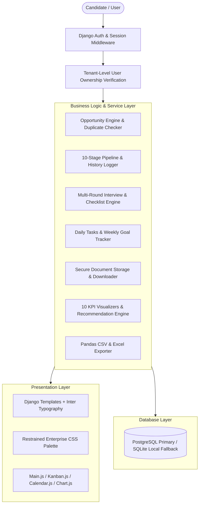
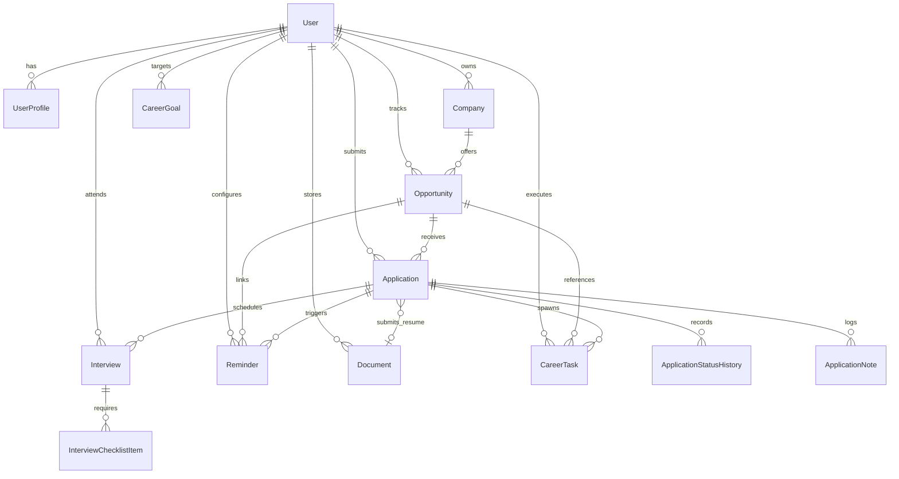
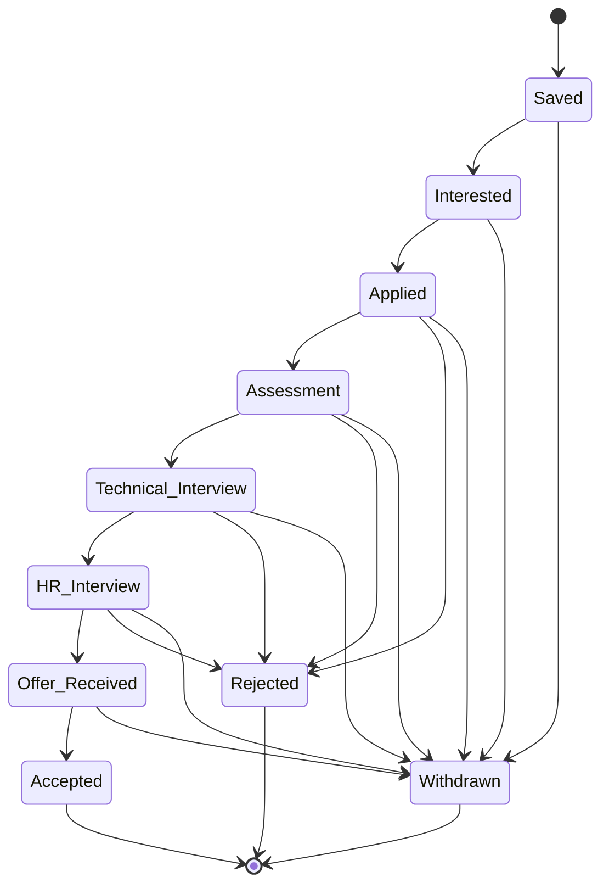

# CareerPilot — System Architecture & Data Model

## 1. Architectural Design
CareerPilot is architected as a modular Django web application following strict Domain-Driven Design principles, full user data isolation, and a professional enterprise UI design system.

---

## 2. Entity-Relationship (ER) Diagram

---

## 3. Application Pipeline State Machine

Applications progress through 10 distinct stages. Any transition triggers an automatic `ApplicationStatusHistory` event with timestamp and transition notes:

